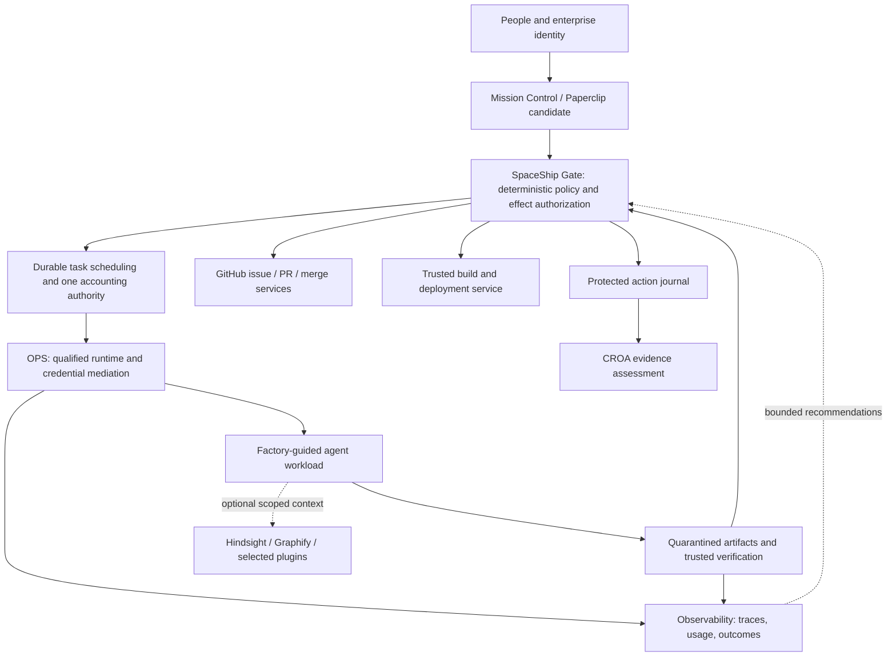

# Æion SpaceShip — architecture and industrialization plan

Decision baseline: **2026-10-23**. Status: **design for review**. Deployment target: **local Docker
first, then one installation inside each company's infrastructure**. A shared SaaS is outside
the first release. The product name is Æion SpaceShip; its cockpit is Mission Control.

## Product outcome

A nonexpert should be able to select a repository, state an outcome, choose an approved operating
profile and understand what is running, why it is allowed, what it costs and what needs a decision.
The system should turn supported work into verified software while preserving explicit company
constraints. “No corrective human intervention” is a measured task outcome, not a permission to
remove governance or hide failed attempts.

The system is **a software factory with deterministic authority**. Agents are replaceable workers.
They do not become a CEO with administrative access. No model call is needed to decide whether
a signed artifact, current check, allowed capability or atomic budget reservation exists.

## Architecture decisions

| ADR | Decision | Reason and qualification gate |
| --- | --- | --- |
| 01 | Five independent Æion repositories | Keep minimum adoption cheap; SpaceShip composes rather than replaces |
| 02 | Single-company local deployment first | Prove boundaries and recovery before multi-tenant hosting |
| 03 | Paperclip is the first work/cockpit foundation to qualify | It already has tasks, company scope, schedules, adapters and accounting; avoid rebuilding them |
| 04 | SpaceShip Gate owns protected-action authorization | Generic task completion or agent approval messages cannot authorize delivery |
| 05 | OpenShell stable release is the first OPS runtime candidate | Reuse enforcement; qualify host, policy, auth path and release together |
| 06 | No agent receives a host Docker socket or merge/deploy credential | Separate coding capability from delivery authority |
| 07 | Default PR mode is hybrid; manual and scoped autonomous modes exist | Match risk appetite without treating AI scores as authorization |
| 08 | Trusted facts and exact artifact identity govern every transition | Prevent stale checks, changed branches and self-approved policies |
| 09 | One accounting authority per dispatch path | Prevent dual reservation or inconsistent budget decisions |
| 10 | OTel is analysis transport; protected transitions need durable records | Sampled/asynchronous telemetry is insufficient for authorization evidence |
| 11 | Model profiles start fixed/shadow, then bounded canaries | Compare complete tasks before enabling adaptive routing |
| 12 | Memory and diagrams remain evidence/context tools | Generated knowledge never outranks current source or policy |
| 13 | No universal plugin installation | Select by need, pin, inspect effects, qualify and enable explicitly |
| 14 | PostgreSQL and an outbox are the production persistence baseline | Reuse Paperclip's store where supported; no mandatory queue/cache cluster |
| 15 | Temporal and a standalone policy service are conditional additions | Introduce only if measured recovery/policy needs exceed the selected backend |

These are architecture decisions, not claims that a compatible Paperclip/OpenShell integration
already exists. The [reuse study](knowledge/operations/integrations-and-reuse.md) separates source
facts, proposed roles and unresolved gates. Internal source functions are not a supported public
API. A failed extension experiment can change ADR 03 without changing the authority contract.

## Authority boundaries

The arrows are proposed trust relationships, not implemented network routes. Paperclip and Gate
may share a deployment/database while using separate roles and tables. Agent-facing writes
cannot update the policy, approval or effect-authority domain. A memory service or plugin cannot
reach those write endpoints. GitHub and deployment systems independently enforce their scopes.

## Reuse, build and defer

**Reuse first:** Factory issue labels and PR habits; OPS controls and runtime qualification;
CROA's audit packet format; Observability's outcome/usage semantics; Paperclip's proven work and
accounting paths; GitHub's native branch rules, checks and environment protection where available.

**Build only the Æion-specific gap:** company policy compilation, authoritative fact collection,
policy decisions with explanations, exact-action approval binding, protected-effect reconciliation,
integration contracts and an accessible cockpit exposing these decisions.

**Defer:** a new agent harness, container runtime, LLM router, memory database, universal deployment
platform, self-hosted identity provider, vector store, enterprise SaaS and autonomous policy writing.
Hindsight, Graphify and Archify enter only after the vertical delivery path works. Orca remains
optional; enabling it must not create a second source of permissions.

## Operating modes

| Dimension | Initial behavior | Later permitted behavior |
| --- | --- | --- |
| External effects | Preview records only | Explicit repository/environment allowlists and scoped receiver credentials |
| Agent concurrency | One worker | Raise after lease, isolation and reservation race tests |
| PR governance | Manual or hybrid in demo | Explicit autonomous scope; no protection bypass |
| Deployment | Local disposable preview | Per-company targets qualified separately |
| Model choice | Fixed approved profile / shadow | Qualified fallback and limited canaries; task-bound strategy |
| Evidence | Complete synthetic fixtures + real local verifier results | Trusted runtime/forge/provider joins with visible gaps |
| Audit | Export assessment evidence | Independent deployed-scope validation; never automatic certification |

Choosing an autonomous mode is a policy publication requiring the appropriate owner. It is not a
checkbox inside an untrusted task. A strong AI review may help reject a proposal; it cannot
promote a protected change into a safe category.

## Delivery milestones

| Gate | Deliverable | Required evidence |
| --- | --- | --- |
| G0 | Reviewed contracts and source register | Exact versions, owner roles, unresolved compatibility items |
| G1 | Paperclip/OPS integration spike | Actual extension seam, denied capabilities, accounting/lease tests |
| G2 | Offline ParcelDesk mission | Reproducible bug, deduplication, frozen candidate, deterministic decisions |
| G3 | Real sandboxed coding mission | Both retained auth paths qualified or explicitly unsupported; bounded paid pilot |
| G4 | GitHub demo repository | Scoped App, verified webhooks, one ticket, one PR, stale-check rejection |
| G5 | Delivery and human approval | Digest-bound deployment, fresh step-up where required, health and recovery |
| G6 | Measured optimization | Comparable task cohorts, complete cost, intervention evidence, rollback |
| G7 | Company installation package | Identity, backups, updates, incident runbooks and support matrix |

The [implementation plan](knowledge/operations/implementation-and-poc.md) provides work packages,
dependencies, acceptance cases and go/no-go conditions. Do not ship a company deployment by
skipping G1 because the cockpit looks complete. There is deliberately no unsupported calendar
estimate; staffing, extension stability and host qualification remain unknown.

## Product promises and exclusions

Promise explicit scopes, reasons and evidence for supported paths. Publish limitations per
runtime, harness, model, provider, operating system and target. Refuse unknown mandatory evidence.
Never promise perfect security, universal provider compatibility, zero API overshoot from a
dashboard, deterministic model answers, zero defects or a compliance certification.

The four existing projects retain their own claims. CROA's current repository assesses evidence;
it does not implement all runtime controls. OPS and Observability currently contain specifications.
SpaceShip will have to implement and qualify their contracts before displaying a passing badge.

## Review package

All documents under [knowledge/](knowledge/index.md) form this plan. Inactive machine-readable
[examples](examples/README.md) make the proposed contracts concrete. [Research sources](knowledge/references/research-register.md)
and the [upstream lock](knowledge/references/upstreams.lock.json) make reuse decisions inspectable.
The OPS sibling also contains the complete pinned Cloudflare audit skill and a weekly maintenance
runbook; this plan does not claim an installed scheduler or a completed target audit.
