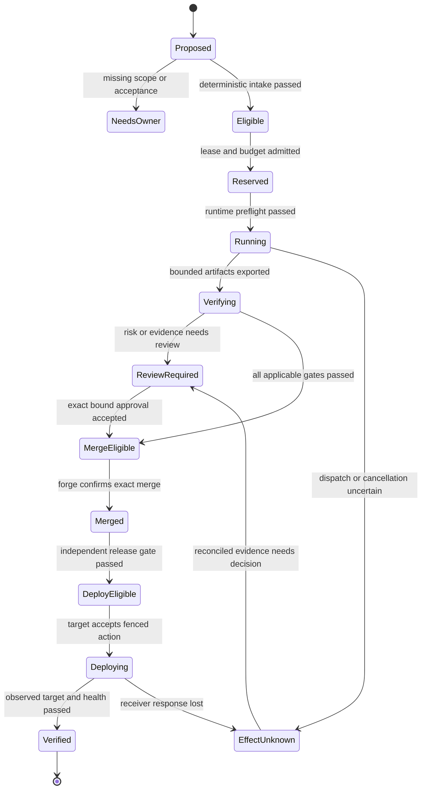

# Architecture and state

## One owner for each kind of truth

| Domain | Proposed owner | What cannot establish this truth |
| --- | --- | --- |
| Work assignment and schedule | Qualified Paperclip backend | A parallel agent declaring itself the assignee |
| Company policy and action authorization | SpaceShip Gate | Prompt text, a memory, task label or model score |
| Financial admission | One qualified ledger on the dispatch path | Dashboard aggregates or two independent budget counters |
| Runtime enforcement | OPS supervisor / qualified OpenShell profile | CLI permission strings or an agent attestation |
| Source and PR state | GitHub, observed by trusted connector | A webhook payload alone or cached UI state |
| Acceptance evidence | Trusted verifier | Agent-authored test logs or a self-reported `done` status |
| Deployment state | Receiver-side deployment adapter | An accepted HTTP request or a merge event |
| Performance analysis | Observability | A metric changing a permission or marking a release approved |
| Audit assessment | CROA packet and assessor | Automatic conformance badge from a trace exporter |

Paperclip and Gate may be modules in one deployment. They still need different authorization
surfaces. Do not introduce microservices merely to draw a boundary: enforce it with receiving
interfaces, database roles, protected state and independently tested execution paths. A remote
service becomes necessary only when the chosen runtime/credential boundary requires it.

An agent may request a transition or submit an artifact. It cannot write the authoritative
`approved`, `verified`, `merged` or `deployed` fields. Paperclip's task lifecycle can show work
completion while SpaceShip's release lifecycle still waits for independent checks.

## Decision model

```text
decision = evaluate(
  policy_bytes_and_version,
  normalized_request,
  authenticated_principal_and_scope,
  validated_fact_snapshot,
  prior_state_and_generation,
  recorded_time
)
```

This is pseudocode, not a published SDK. The evaluator performs no network request or model call.
Fact collection happens first and records source, observation time, validity interval and digest.
Explicitly order rules: invalid schema → wrong scope → revoked/expired authority → missing
required evidence → prohibited capability → budget/deadline → risk/review requirements → eligible.
Sort unordered inputs, normalize money without binary floats, and use a documented total ordering
for profile ties. Capture the evaluator build/version and normalized input digest in the decision.

The same input can be replayed to reproduce the same reason codes. A later action requires a
new freshness check; a replayed old `allow` is not a reusable authorization token. Cache a policy
evaluation only when every authority-bearing input and its expiry remain bound to the cache key.

OPA is a possible evaluator once policy breadth justifies it. Its result still needs an enforcing
receiver. The first slice may use a small pure typed function plus explicit tables rather than
adding a Rego service. Both must pass the same rule fixtures. Model-assisted policy authoring
creates a proposal for an owner, never a hot reload of executable authority.

## Entity and identity model

| Entity | Minimum binding / lifecycle |
| --- | --- |
| Company | Immutable ID, operator identity configuration, installation boundary |
| Project | Company ID, approved repository numeric ID, data class, policy binding |
| Task | Acceptance contract, family, risk, source revision, deadline, budget scope |
| Finding | Stable rule/fingerprint, source identity, evidence refs, certainty/sensitivity |
| Run | Task ID, attempt ID, frozen policy/profile/runtime, lease generation, outcome |
| Artifact | Content digest, size/type inventory, producer/run/source, quarantine status |
| Check | Definition digest, toolchain/runner identity, tested source/artifact, result |
| Decision | Input/policy/evaluator identities, reason codes, expiry, requested action |
| Approval | Principal/role, exact action binding, assurance, expiry, consumed/revoked state |
| Reservation | Financial authority, request exposure, currency/unit, held/settled/uncertain |
| Effect | Receiver/action identity, expected state, idempotency/reconciliation identity, receipt |
| Outbox item | Intended effect, delivery state, lease, retry deadline, attempt evidence |
| Intervention | Required approval versus corrective help/repair, duration, provenance |

Use installation-generated IDs, not user-controlled labels, as authority keys. A model alias,
repository display name or GitHub issue number is insufficient without its owning scope.
Keep immutable records or append revisions; never overwrite an old approval with a new SHA.

## Task and release state machines



The diagram omits common terminal `cancelled`, `failed`, `expired` and `quarantined` edges for
readability; each active state must define them in the transition table. Transitions specify
actor, preconditions, current generation, evidence, budget treatment, emitted events and recovery.
There is no general-purpose `set_status` endpoint allowing a worker to skip the graph.

A defect's ticket lifecycle is related but separate: open → triaged → assigned → PR → resolved →
verified/closed or reopened. Merging a PR does not prove production resolution. Task success
also remains provisional until its declared acceptance horizon and intervention coverage mature.

## Transaction boundaries

For a protected transition, atomically validate expected state/generation, consume the applicable
one-use authority, reserve resources if required, append the durable decision/event and insert an
outbox command. Commit before attempting the external effect. A rollback grants no authority.

Use the backend's established lock order. Paperclip source already serializes accounting through
a company row before run/policy locks; an extension must fit that order. Do not add a second
lock hierarchy by importing an internal helper and guessing transaction ownership. Integration
tests must demonstrate concurrent admission, settlement and cancellation with deadlock handling.

The external service is not part of the database transaction. An outbox worker records
`pending → leased → sent → confirmed`, with `unknown` when dispatch may have happened. Reconcile
receiver state before retrying an uncertain mutation. A hash marker helps search; it is not an
exactly-once guarantee from GitHub. Terminal receipts include receiver identity and observed state.

## Leases, fencing and cancellation

Use a renewable lease and monotonically increasing execution generation. Losing the lease stops
the worker's authority. The receiver must reject old generations; a database row alone cannot
stop an orphan process from calling an API with a still-valid credential. Bound capabilities to
run/generation, expire them quickly and revoke mediated access on cancellation.

A lease expiry does not mean a provider call was free or a command never ran. Preserve uncertain
exposure/effects until reconciliation. Do not schedule a replacement worker that can duplicate an
unresolved deployment or migration. Reclaim only after the declared recovery policy resolves or
quarantines the previous generation. Cancellation has a durable request and a separate observed
completion; the UI displays both.

## Persistence and failure model

Prefer the selected Paperclip PostgreSQL deployment and supported extension mechanism. Keep
protected Gate tables and service permissions separate from agent-facing task writes. The exact
schema migration path is a G1 spike, not an assumed upstream plugin API. A small SQLite laboratory
can validate local decision fixtures, but cannot be promoted by changing only a connection string.

Required failure tests cover process crash, database outage, duplicate delivery, out-of-order
webhooks, expired leases, clock skew, restore from backup and lost provider/forge responses.
Bound retries, queues, logs and artifact size. Store content externally only when the selected
backend needs it; a new object-storage cluster is not mandatory for one local mission.

Temporal is a later option for long-lived distributed workflows. Its deterministic workflow
replay does not make external activities exactly once; activity idempotency still matters.
Do not run both Temporal and Paperclip schedulers as competing owners of the same task.

## CROA mapping and evidence

The proposed mapping is C1 → policy registry; C2 → admission governor; C3 → approved path/profile
resolution; C7 → compiled action contract; C6 → receiving execution firewall; C4 → invariant
monitor; C5 → protected provenance. Preserve the upstream sequencing and audit each applicable
boundary rather than claiming a file with a matching name implements a CROA component.

Durable transition evidence must exist before the protected transition. Telemetry export is a
derived view, not C5 durability. Children cannot gain more authority by combining individually
small grants; account for cumulative/union exposure. This design is a proposed implementation
mapping to the pinned CROA framework, not an assessment result or conformance level.
